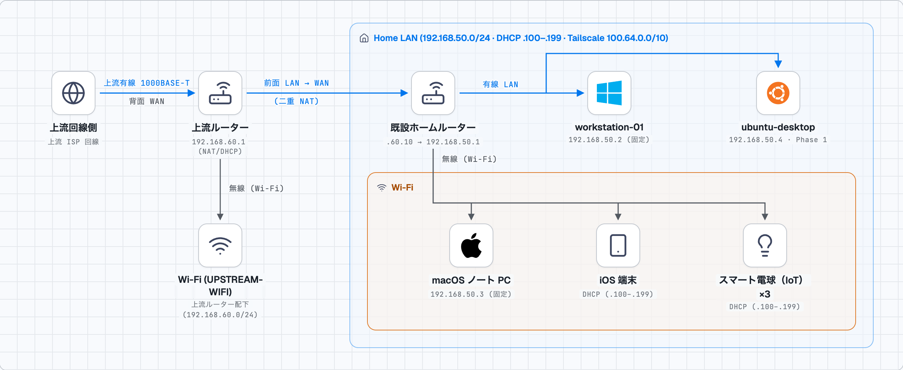

# 自宅ネットワークの構成（サンプル）

状態： 運用中（サニタイズ済みサンプル構成。実 LAN サブネット・Tailscale 実 IP・上流 ISP 名・備付機器型番はすべて架空プレースホルダーへ置換済み）

自宅ネットワークの接続構成・IP 設計・Tailscale 閉域構成の整理。将来の刷新計画は後半に分けて記す。

## 上流回線・二重 NAT 構成

- **回線構成**：上流 ISP 回線 → 上流ルーター（NAT・DHCP `192.168.60.0/24`） → 既設ホームルーター（LAN `192.168.50.0/24`）の **二重 NAT 構成**
- **外部アクセス方針**：上流がプライベート IP のため外部からの直接ポート開放は前提にせず、自宅外からのアクセスは **Tailscale 閉域メッシュ**を本線とする
- **HTTPS 終端**：Cloudflare DNS-01 認証で `*.home.example.com` の Let's Encrypt ワイルドカード証明書を取得し、DNS A レコードは Tailscale IP（`100.64.0.10`）へ向ける

## LAN / DHCP サーバー設定（サンプルサブネット）

- サブネット：`192.168.50.0/24`（ネットマスク `255.255.255.0`）
- デフォルトゲートウェイ：`192.168.50.1`（既設ホームルーター）
- DHCP サーバー：有効
  - 配布プール：`192.168.50.100` – `192.168.50.199`
  - リース時間：`120 分`
  - 配布 DNS：プライマリ `8.8.8.8` / セカンダリ `8.8.4.4`
- アドレス予約（固定 IP）方針：`.2` / `.3` / `.4` のように DHCP プール（`.100`–`.199`）の外側へ割り当て（`.4` は `ubuntu-desktop` 側で静的固定）

## 接続方式と IP アドレス（LAN / 上流・サンプル値）

| 機器 | 接続方式 | 割当方式 | IP（サンプル） | ホスト名・備考 |
|---|---|---|---|---|
| 上流ルーター（備付） | 上流有線 1000BASE-T | 固定 | `192.168.60.1`（上流 LAN GW） | 上流 NAT・DHCP 稼働。既設ホームルーター WAN へ有線接続 |
| 既設ホームルーター | 上流ルーター配下（有線 WAN） | 固定（自宅 LAN 側） | `192.168.50.1` | 自宅 LAN ゲートウェイ（WAN 側 `192.168.60.10`） |
| Windows デスクトップ（`workstation-01`） | 有線 LAN | アドレス予約（固定） | `192.168.50.2` | `workstation-01.local` |
| macOS ノート PC（`laptop-01`） | 無線（Wi-Fi） | アドレス予約（固定） | `192.168.50.3` | `laptop-01.local` |
| iOS 端末（`mobile-01`） | 無線（Wi-Fi） | DHCP（動的） | `192.168.50.101`（例） | `mobile-01.local` |
| スマート電球（IoT） ×3 | 無線（Wi-Fi） | DHCP（動的） | DHCP プール内 | 将来 IoT VLAN へ分離予定 |
| Linux デスクトップ（`ubuntu-desktop`） | 有線 LAN（`eno1`） | 静的固定（ホスト側設定） | `192.168.50.4` | `ubuntu-desktop.local`（`e1000e` NIC 向けに `/etc/NetworkManager/dispatcher.d/99-eno1-e1000e-tuning` で `EEE`・`TSO`・`GSO` 無効化を永続適用） |

- `ubuntu-desktop` 有線 NIC（`eno1` / `e1000e`）：間欠的な外部通信断と `rx_crc_errors` 蓄積の予防策として、起動・リンクアップ時の `EEE off`・`tso off`・`gso off` を NetworkManager dispatcher と Ansible `base_hardening` ロールで永続化済み。再発時は LAN ケーブル交換またはルーター側ポート変更で物理層を切り分ける方針

## Tailscale（運用中・プレースホルダー IP）

自宅外・環境間のメッシュ接続として Tailscale が稼働中。二重 NAT 環境のため自宅外からのアクセスは Tailscale 経由が本線。以下の IP は RFC 6598 範囲内のサンプル値。

| ノード名 | 対象機器 | Tailscale IP（例） | 状態 |
|---|---|---|---|
| `ubuntu-desktop` | Linux デスクトップ | `100.64.0.10` | 稼働中（Tailscale 経由 SSH 22 番・`*.home.example.com` HTTPS 443 番・`Disable key expiry` 有効） |
| `remote-vm-01` | 外部 VM | `100.64.0.20` | 稼働中 |
| `laptop-01` | macOS ノート PC | `100.64.0.30` | 稼働中 |
| `workstation-01` | Windows デスクトップ | `100.64.0.40` | 稼働中 |
| `mobile-01` | iOS 端末 | `100.64.0.50` | 稼働中 |

## 設計・今後の予定（未導入）

現況には含めない。目標構成図の全体像は [自宅基盤の目標構想](target-architecture.md)、選定理由は [ネットワーク機器の選定記録](decisions/0003-network-yamaha-stack.md) を参照。

- **ネットワーク刷新構想（Yamaha 構成・検討中）**：L3・L2・AP を Yamaha 法人向け機器で揃える案（RTX830 親機による LAN マップ一括可視化・タグ VLAN による IoT 分離・SSH でのコンフィグ Git 管理を想定）
  - **L3 ルーター候補**：`Yamaha RTX830`（1GbE。上流ルーター配下へルーターモードで接続する前提。二重 NAT 環境のため外部向け VPN よりも VLAN・フィルタ・コンフィグ管理を中心に活かす）
  - **L2 スイッチ候補**：`Yamaha SWX2210-8G`（スマート L2 / 1GbE×8 / ファンレス / 電源内蔵 / 非 PoE。単体 Web GUI・タグ VLAN・ACL・SNMP 対応）
  - **無線 AP 候補**：`Yamaha WLX222`（Wi-Fi 6 / マルチ SSID + 802.1Q タグ VLAN / 2.5GbE ポート / RADIUS 内蔵。AC アダプタ別売のため非 PoE の `SWX2210-8G` と組む場合は純正 AC アダプタ `YPS-12HT` または PoE インジェクタが必要）
  - **移行の段階案**：WLX222 導入前は既設ホームルーターを AP モードへ転用して段階移行できる。NAS 導入後に 2.5GbE 以上が必要になった場合は別途マルチギガスイッチの併用を検討する
- **NAS 接続**：UGREEN NASync DXP4800 Plus は 10GbE + 2.5GbE を備える（[選定記録](decisions/0002-nas-ugreen-dxp4800-plus.md)）。導入時は有線接続かつ DHCP プール外（例：`192.168.50.10`）のアドレス予約を前提とする
- **NAS のリモートアクセス**：[データの置き場所の方針](database-policy.md) に沿い、既存の Tailscale へ参加させる前提
