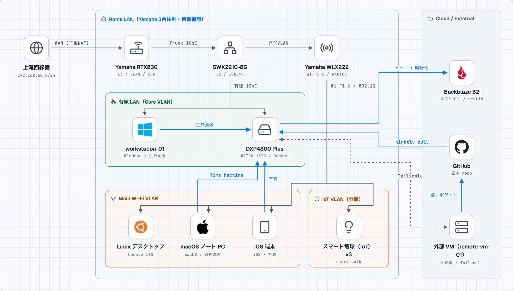

# 自宅基盤の目標構想（Yamaha 3台体制＋バックアップ）

状態： 設計（未構築）

将来の自宅基盤の目標像。Yamaha 3台体制（`RTX830`・`SWX2210-8G`・`WLX222`）による VLAN 分離・LAN マップ管理と、UGREEN NASync DXP4800 Plus を軸にした一方向バックアップ体制を1枚にまとめたもの。

※ 現況（稼働中）は [自宅デバイスの現況](devices.md) と [自宅ネットワークの現況](network.md) を参照。設計と現況を混同しないこと。

## 目標構成図

- 自己完結 HTML：[diagrams/target-architecture.html](diagrams/target-architecture.html)（`caru-ini/stack-diagram` で生成）

## 構成の柱

### 1. ネットワーク（Yamaha 3台体制）
選定経緯は [ネットワーク機器の選定記録](decisions/0003-network-yamaha-stack.md) を参照。

- **L3 ルーター**：`Yamaha RTX830` — ルーティング、DHCP、VLAN 間フィルタ、SSH によるコンフィグの git 管理、LAN マップ（L2MS マネージャー）
- **L2 スイッチ**：`Yamaha SWX2210-8G` — 1GbE×8 ファンレス・電源内蔵。Core VLAN とトランク接続を収容
- **無線 AP**：`Yamaha WLX222` — マルチ SSID + 802.1Q タグ VLAN で **Main Wi-Fi VLAN**（macOS ノート PC・Linux デスクトップ・iOS 端末）と **IoT VLAN**（スマート電球（IoT） ×3）を分離。内蔵 RADIUS で 802.1X 検証にも対応
- **外部接続**：上流 ISP 回線→ 上流ルーター（`192.168.60.0/24`）配下の二重 NAT 環境のため、自宅外からのアクセスと 外部 VM（remote-vm-01） 連携は引き続き **Tailscale** を本線とする

### 2. バックアップとデータの流れ
詳細は [バックアップ体制の設計](backup-design.md)・[NAS 選定記録](decisions/0002-nas-ugreen-dxp4800-plus.md)・[Backblaze B2 選定記録](decisions/0001-cloud-backup-backblaze-b2.md) を参照。

- **一方向の原則**：双方向同期は使わず「端末 / GitHub → NAS → Backblaze B2」の一方向へ寄せる
- **端末 → NAS**：`workstation-01` は生成画像、`macOS ノート PC` は Time Machine、`iOS 端末` は写真を `DXP4800 Plus`（RAID6 実効 16TB）へ送る
- **GitHub → NAS**：各正本 repo を NAS 上の Docker から nightly pull でローカルミラーする（NAS から書き戻さない）
- **NAS → Backblaze B2**：写真・書類・メディア原本・NAS 設定を restic でクライアント側暗号化して日次送信し、月1回復元テストを行う
- **外部 VM（remote-vm-01） → GitHub**：別リポジトリ（外部 VM バックアップ） で記憶とプロファイルを継続退避（運用中）

### 3. 監視基盤（Zabbix + PostgreSQL）
詳細は [監視基盤の設計](monitoring-design.md) と [監視ツール選定記録](decisions/0004-monitoring-zabbix.md) を参照。

- **統合監視**：`Zabbix`（Docker + PostgreSQL）で Yamaha 3台（SNMP）・PC / NAS（Zabbix Agent 2）・スマート電球（IoT）（ICMP）・`restic` / 同期ジョブ（Zabbix Trapper）・外部 VM（remote-vm-01）（Tailscale 経由）を一元監視する
- **DB と退避の整合**：バックエンドに PostgreSQL を採用し、`pg_dump` → `restic` → Backblaze B2 のバックアップ経路へ組み込む

### 4. デバイス管理（Fleet・NetBox・Ansible）
詳細は [デバイス管理の設計](device-management-design.md) と [デバイス管理ツール選定記録](decisions/0005-device-management-fleet-netbox.md) を参照。

- **エンドポイント管理・監査**：`Fleet（FleetDM Free）`（Docker）で PC 3台（macOS / Windows / Linux）のソフト棚卸し・CVE 検知・セキュリティ監査・手動 MDM 検証を行う（Apple MDM 補助として `Jamf Now` 無料枠を任意併用）
- **機器・IP 台帳（DCIM / IPAM）**：`NetBox`（Docker + PostgreSQL）で Yamaha 3台・VLAN・IP・配線・全端末の構成正本を持ち、将来の `Ansible` 自動化のインベントリ起点とする

### 5. ID・秘密情報管理・HTTPS 窓口（Authentik・1Password・Caddy）
詳細は [ID・秘密情報管理の設計](identity-design.md)・[ID 管理選定記録](decisions/0006-identity-authentik-1password.md)・[リバースプロキシ選定記録](decisions/0007-reverse-proxy-caddy-wildcard-tls.md) を参照。

- **IdP / SSO**：`Authentik`（Docker + PostgreSQL、Redis 不要構成）で Zabbix（SAML 2.0）・NetBox（OIDC）・Fleet Free（SAML 2.0）のログインと MFA を統合し、将来は Yamaha `WLX222` の 802.1X（RADIUS）や NAS の LDAP 認証まで広げる
- **HTTPS リバースプロキシ**：`Caddy`（Docker + Cloudflare DNS-01）で所有ドメイン `*.home.example.com` のワイルドカード証明書を自動管理し、Tailscale IP 向けの閉域 HTTPS 窓口として各管理アプリを束ねる
- **秘密情報・復旧鍵の金庫**：自宅外の **1Password** に Break-glass 管理者・DB パスワード・API トークン・SSH 鍵・リカバリコードを集約し、自宅停止時にも確実に復旧できる構成とする

## 段階移行の順序（想定）

1. **秘密情報ルールの先行統一（1Password 導入は一旦保留）**：将来は全基盤のパスワード・鍵・トークンを 1Password へ集約する方針。当面はホストの `chmod 600 .env`（git 管理外）と手元管理で運用
2. **監視・管理基盤の先行検証 — Phase 1 完了（稼働中）**：`ubuntu-desktop` 上の Docker で Caddy（`*.home.example.com`）・Zabbix 8.0 LTS・NetBox v4.7・Fleet Free v4.95.0・Authentik 2026.8.5 を立ち上げ、全 3 基盤の SSO 連携まで完了（MFA は Issue #2、先行 DB バックアップは Issue #3、Ansible は Issue #4）
3. **NAS・バックアップ構築**：`DXP4800 Plus` + WD Red Plus 8TB ×4 を現行ルーター（既設ホームルーター）配下に有線接続してバックアップ体制を立ち上げ、Caddy・Zabbix・NetBox・Fleet・Authentik を NAS 上の Docker へ集約する
4. **L3・L2 刷新**：`RTX830` + `SWX2210-8G` を導入し、既存 `既設ホームルーター` を AP モードへ切り替えて有線 VLAN・SSH コンフィグ管理・SNMP 監視・NetBox IPAM 連携・Ansible 自動化を始める
5. **無線 AP 刷新**：`WLX222`（＋純正 AC アダプタ `YPS-12HT` または PoE インジェクタ）を導入し、Main Wi-Fi VLAN と IoT VLAN の分離および Authentik（RADIUS）との 802.1X 連携を進める

